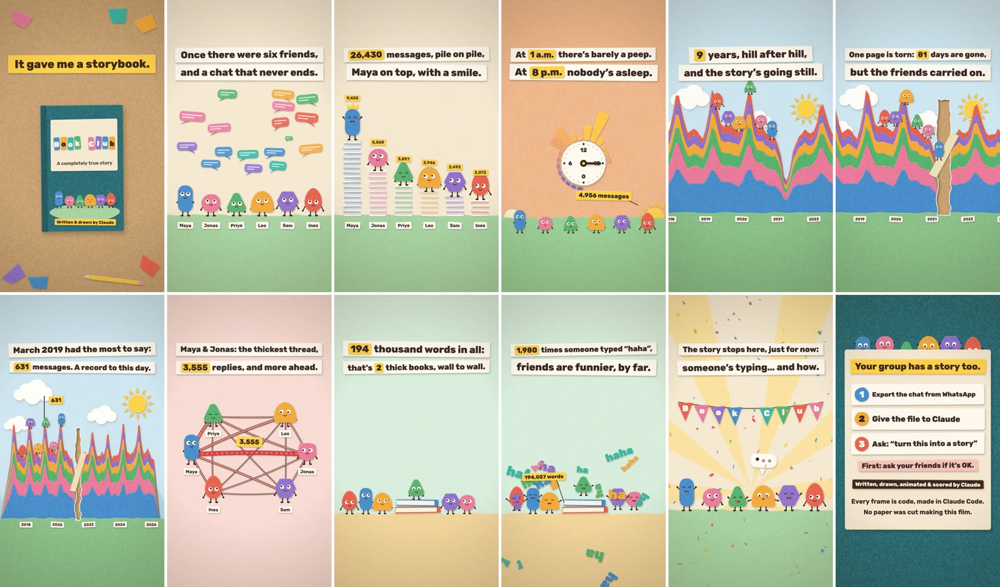

# Chat Storybook

A Claude Code skill that turns a WhatsApp chat export into a 66-second paper-cut storybook film: the story of a group of friends, a family or a team, told in numbers and rhyme.



*The frames above come from an invented chat written by `examples/fake_export.py`. No real conversation is in this repository.*

## What you get

- `film.mp4`: 1080x1920, 24 fps, 66 seconds, with an original soundtrack that is synthesized for each film. Add `--crop45` for a 4:5 feed version.
- A render takes a minute or two on a recent laptop. Each file is about 29 MB; `--kbps 1800` roughly halves that.
- Eight scenes: the cover, the friends, the clock, the years, who answers whom, the words, "to be continued", and an invitation to try it.
- English, or Hebrew drawn right to left with an English subtitle strip ([Hebrew frames](docs/preview-he.jpg)). Other languages work through a copy pack.
- Counts and first names only. No message is ever quoted.

## Install

In Claude Code:

```
/plugin marketplace add roy-aniccai/chat-storybook
/plugin install chat-storybook@chat-storybook
```

Or copy the skill by hand:

```bash
git clone https://github.com/roy-aniccai/chat-storybook
cp -r chat-storybook/skills/chat-storybook ~/.claude/skills/
```

It needs Python 3.9+, Node.js 18+, ffmpeg and a Playwright Chromium. The skill checks for them and prints the install commands when something is missing.

## Use

1. In WhatsApp, open the chat, then **More > Export chat > Without media**. Save the `.zip`.
2. In Claude Code, say something like:

   > Make a storybook film from this WhatsApp export: ~/Downloads/WhatsApp Chat with Sunday League.zip

3. Claude shows you the facts it counted, asks who any unsaved phone number is and for a short title, shows twelve preview frames, and then renders the film.

No chat at hand? Make an invented one first:

```bash
python3 examples/fake_export.py "WhatsApp Chat with Sunday League.zip" --months 40 --gap-days 80
```

### By hand

```bash
S=skills/chat-storybook/scripts
python3 -I $S/stats.py "WhatsApp Chat with Sunday League.zip" -o work/story.json
python3 -I $S/film.py --check
python3 -I $S/film.py work/story.json --out film.mp4 --preview   # twelve frames
python3 -I $S/film.py work/story.json --out film.mp4 --crop45    # the film
```

Both scripts list their flags with `--help`.

### If something goes wrong

- **`page.screenshot: Timeout`**: the computer went to sleep while the frames were being drawn. Keep it awake and plugged in, then run the command again.
- **`playwright MISSING` but you have Playwright**: point the scripts at it by putting `PLAYWRIGHT_CORE=/path/to/playwright-core/index.mjs` in front of each `film.py` command.
- **A refusal** (too few messages, an unnamed phone number, a title that does not fit): the message says what to change. These stops are on purpose.

## Privacy

- The scripts run on your machine and make no network calls. The font is bundled.
- `stats.py` reads the export and writes `story.json`: names, counts per hour and month, who replies to whom, a word count, and how often people laughed. No message text leaves the parser.
- The skill tells Claude not to open the chat text, and to show numbers without guessing at the reasons behind them. Claude does see the facts table and the preview frames, like anything else in your session.
- Phone numbers are masked. A sender saved only as a number has to be given a name before a film is made.
- Other people wrote that chat with you. Ask them before you post the film.

## Make it yours

The film says on its cover that Claude wrote and drew it, and its last ten seconds are a card that invites other people to try this with their own chat. `--no-outro` ends the film at 0:55, just before the page turns to that card. The cover line is `byline` in the copy pack.

The wording lives in `scripts/copy/en.json` and `scripts/copy/he.json`. Copy one, edit the lines, and pass it with `--copy my.json`. Keep the same number of lines in each caption block.

In a caption, `{name}` puts a number on a paper chip and `[name]` inserts plain text.

| Variable | Meaning |
|---|---|
| `title` | the cover title |
| `years`, `spanMonths` | length of the chat |
| `[span]`, `[Span]`, `[spanEn]`, `[SpanEn]` | the length as words ("9 years"), lower-case or capitalized; the `En` forms are for the subtitle strip |
| `nWord`, `nWordEn` | number of people as a word |
| `total` | all messages |
| `top` | the most active person |
| `quietH12`, `quietPart`, `quietAmpm` | the quietest hour: 12-hour number, part of the day, "1 a.m." |
| `peakClock`, `peakAmpm`, `peakHn` | the busiest hour: "20:00", "8 p.m.", messages sent in it |
| `gapDays` | the longest silence, in days |
| `peakMonth`, `peakMonthEn`, `peakMn` | the busiest month and its message count |
| `pairA`, `pairB`, `pairN` | the two people who answer each other most, and how often |
| `words`, `wordsK`, `wordsM` | words written: exact, in thousands, in millions |
| `books`, `pages` | the same as 80,000-word books and 300-word pages |
| `laughs`, `laughWord`, `laughBit`, `laughWordEn` | messages with a laugh, and the laugh itself |

A pack can override lines under `variants` for chats that do not fit the default wording:

| Variant | When |
|---|---|
| `duo` | two people |
| `fewbooks` | fewer than two books of words |
| `fewwords` | fewer than 10,000 words |
| `bigwords` | a million words or more |
| `nolaughs` | fewer than five laughs |

A chat with no silence of 45 days or more skips the "torn page" lines.

The Hebrew pack uses the generic masculine plural. For a group that reads better another way, adapt it with `--copy`.

## How it works

```
export.zip -> stats.py -> story.json -> film.py -> film.html (one page, the whole film)
                                          |-> render.mjs  1,584 frames from headless Chromium
                                          |-> audio.mjs   the soundtrack, synthesized from the film's cues
                                          `-> ffmpeg      film.mp4
```

Every frame is drawn in code: paper shapes, shadows and stop-motion timing live in `scripts/film.tpl.html`. Nothing is generated by an image or video model, so the same chat always gives the same film.

## Limits

- The chat needs at least 500 messages, six months and two people. Up to seven people are drawn; the most active are picked.
- Tested with Android and iOS exports in US, European and German date styles. If yours does not parse, open an issue with a few invented lines in the same format. Please do not paste real messages.
- A cover title fits two short words, 14 letters a line at most.
- WhatsApp only, for now.

## Credits

Built at [Aniccai](https://aniccai.com) with Claude Code, starting from an eleven-year group chat between seven friends.

Code is MIT licensed. The bundled font is Rubik, under the SIL Open Font License (`skills/chat-storybook/scripts/fonts/OFL.txt`).

This project is not affiliated with WhatsApp, Meta or Anthropic.
